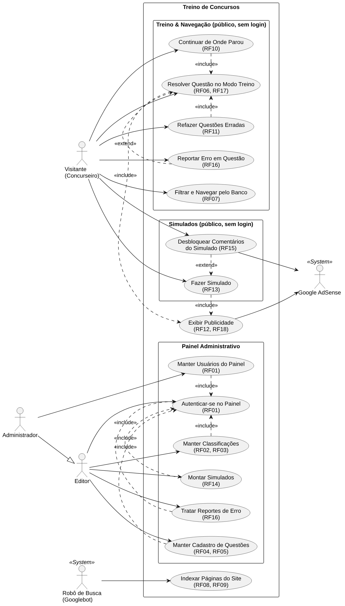
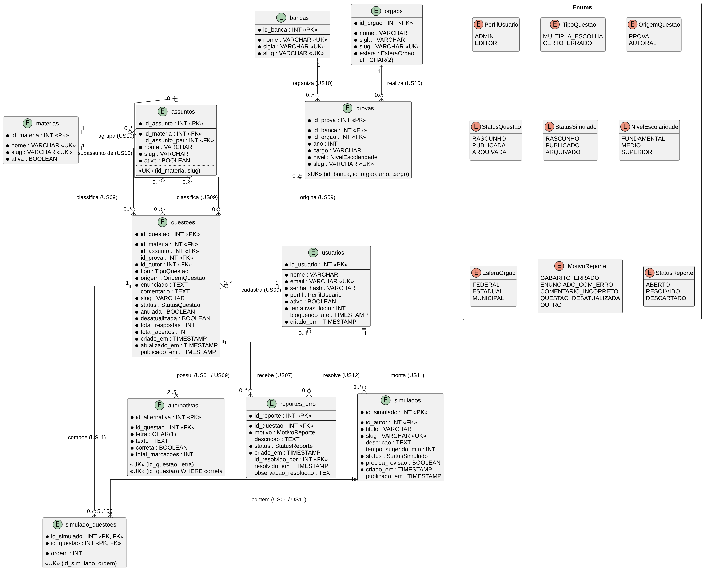

# Especificações Textuais de Requisitos

*Especificações simplificadas*

---

## 1. Título do Projeto

**Treino de Concursos**: banco de questões gratuito e sem limite diário para concursos públicos, mantido por publicidade.

> Nome provisório. Se mudar, troque também o pacote Java (`br.com.treinoconcursos`), o nome do banco e o domínio.

## 2. Identificação

| | |
|---|---|
| **Responsável** | Erick Geovane |
| **Tipo** | Projeto pessoal (produto com receita por anúncios) |
| **Stack** | Java 21 + Spring Boot 4.1, PostgreSQL 17, React 19 + Vite 8 |

## 3. Caracterização dos Pontos de Vista

| Ponto de Vista | Interesses |
|---|---|
| **Visitante (Concurseiro)** | Resolver muitas questões de graça, sem cadastro e sem limite diário. Quer ver o comentário logo depois de responder, continuar de onde parou sem repetir questões e treinar bem pelo celular. |
| **Editor de Conteúdo** | Cadastrar questões rapidamente e classificá-las corretamente (matéria, assunto, banca, órgão, ano). Quer corrigir erros reportados e montar simulados sem depender do desenvolvedor. |
| **Administrador (Dono do Negócio)** | Gerar receita com anúncios sem violar as políticas do Google AdSense, manter o custo de infraestrutura baixo, controlar quem acessa o painel e acompanhar se o conteúdo está trazendo tráfego. |
| **Google AdSense / Anunciantes** | Exibir anúncios em páginas com conteúdo real, com boa visibilidade e sem cliques acidentais. Um site que gera cliques inválidos tem os ganhos reduzidos ou a conta suspensa. |
| **Desenvolvedor / TI** | Arquitetura simples e barata de operar em um único VPS, páginas legíveis pelo Google (renderizadas no servidor), cache eficiente e um painel administrativo seguro. |

## 4. Resumo do Domínio do Problema

Quem estuda para concursos públicos treina principalmente resolvendo questões de provas anteriores. As grandes plataformas do setor oferecem acervos enormes, mas limitam o plano gratuito a cerca de 10 a 15 questões por dia e cobram assinatura mensal para liberar o restante e os comentários dos professores. Para o concurseiro que não pode ou não quer pagar, o limite diário interrompe o estudo justamente quando ele está rendendo.

A proposta deste projeto é desenvolver o **Treino de Concursos**, um banco de questões **sem limite diário e sem cadastro**, mantido por publicidade. O visitante chega por uma busca no Google em uma questão específica, responde, recebe a correção na hora com um comentário explicando cada alternativa e segue para a próxima questão do mesmo assunto. Cada questão é uma página própria, renderizada no servidor, o que permite ao Google indexar o enunciado e o comentário e faz com que cada "Próxima questão" seja uma nova visualização de página com anúncio.

Como não há login para visitantes, o progresso (questões resolvidas, acertos, erros e a última questão vista) fica guardado no próprio navegador. As questões seguem sempre a mesma ordem dentro de cada filtro, o que permite ao visitante **continuar de onde parou** e **pular as questões que já resolveu**, sem a experiência de rever as mesmas questões. Um modo **simulado** permite treinar com correção apenas no final; o gabarito e o desempenho por matéria são gratuitos, e os comentários detalhados podem ser liberados assistindo a um anúncio com recompensa.

O conteúdo é mantido por editores em um **painel administrativo** protegido por login, onde cadastram questões, as classificam, montam simulados e tratam os erros reportados pelos visitantes. Toda a solução é pensada para operar com custo mínimo (um VPS pequeno com Cloudflare na frente) e para respeitar as políticas de posicionamento de anúncios do Google AdSense e a LGPD, sem coletar dados pessoais dos visitantes.

## 5. Análise de Cenários: Casos de Uso UML

Fonte editável: [`diagramas/usecase.plantuml`](diagramas/usecase.plantuml)

## 6. Modelo Lógico do Banco de Dados

Fonte editável: [`diagramas/bancoDeDados.plantuml`](diagramas/bancoDeDados.plantuml). Dicionário de dados, restrições e índices em [`banco-de-dados.md`](banco-de-dados.md).

## 7. Análise de Cenários: Casos de Uso Resumidos

### US01. Resolver Questão no Modo Treino

| | |
|---|---|
| **ATOR(ES)** | 1. Visitante (Ator Principal) 2. Google AdSense (Ator Coadjuvante) |
| **PRÉ-CONDIÇÕES** | 1. A questão deve estar com status PUBLICADA. |
| **PÓS-CONDIÇÕES** | 1. A correção e o comentário da questão são exibidos ao visitante. 2. O resultado (acerto ou erro) é salvo no navegador do visitante. 3. As estatísticas anônimas da questão são atualizadas. |
| **NARRATIVA RESUMIDA** | Este caso de uso é útil quando o visitante quer treinar uma questão, normalmente vindo de uma busca no Google. Ele lê o enunciado e toca em uma alternativa. O sistema destaca a alternativa correta, informa se ele acertou, exibe o comentário e oferece o botão "Próxima questão", que abre a questão seguinte do mesmo filtro em uma nova página. A página exibe um bloco de publicidade em posição segura. |

### US02. Filtrar e Navegar pelo Banco de Questões

| | |
|---|---|
| **ATOR(ES)** | 1. Visitante (Ator Principal) |
| **PRÉ-CONDIÇÕES** | 1. Deve haver questões publicadas no sistema. |
| **PÓS-CONDIÇÕES** | 1. O visitante visualiza a lista de questões que atendem aos filtros, sempre na mesma ordem. |
| **NARRATIVA RESUMIDA** | Este caso de uso é útil quando o visitante quer treinar um recorte específico, como "Português, assunto Crase, banca FGV". Ele escolhe matéria, assunto, banca, órgão, ano ou nível. O sistema lista as questões publicadas em ordem crescente de cadastro, indica quais o visitante já resolveu e permite abrir qualquer uma delas. As combinações principais de filtro têm endereço próprio, que também pode ser indexado pelo Google. |

### US03. Continuar de Onde Parou

| | |
|---|---|
| **ATOR(ES)** | 1. Visitante (Ator Principal) |
| **PRÉ-CONDIÇÕES** | 1. O visitante já resolveu questões neste navegador. 2. O armazenamento do navegador está disponível. |
| **PÓS-CONDIÇÕES** | 1. O visitante é levado à próxima questão ainda não resolvida do filtro escolhido. |
| **NARRATIVA RESUMIDA** | Este caso de uso é útil quando o visitante volta ao site em outro dia e não quer repetir questões. Ele toca em "Continuar de onde parei" em um filtro. O sistema consulta o progresso salvo no navegador, localiza a última questão vista daquele filtro e abre a primeira questão seguinte que ele ainda não resolveu. O visitante também pode ativar a opção "Ocultar questões já resolvidas". |

### US04. Refazer Questões Erradas (Caderno de Erros)

| | |
|---|---|
| **ATOR(ES)** | 1. Visitante (Ator Principal) |
| **PRÉ-CONDIÇÕES** | 1. O visitante errou pelo menos uma questão neste navegador. |
| **PÓS-CONDIÇÕES** | 1. O visitante refaz as questões erradas. 2. As questões acertadas na revisão saem do caderno de erros. |
| **NARRATIVA RESUMIDA** | Este caso de uso é útil para revisar os pontos fracos. O visitante abre o "Caderno de erros", filtra por matéria se quiser e percorre as questões que errou. Ao acertar uma delas, o sistema a retira do caderno. |

### US05. Fazer Simulado

| | |
|---|---|
| **ATOR(ES)** | 1. Visitante (Ator Principal) 2. Google AdSense (Ator Coadjuvante) |
| **PRÉ-CONDIÇÕES** | 1. O simulado deve estar com status PUBLICADO. |
| **PÓS-CONDIÇÕES** | 1. O visitante vê o percentual de acertos, o desempenho por matéria e o gabarito de cada questão. 2. O resultado é salvo no navegador. |
| **NARRATIVA RESUMIDA** | Este caso de uso é útil para treinar em condições parecidas com as da prova. O visitante escolhe um simulado e responde às questões sem ver a correção, podendo voltar e trocar respostas. Ao finalizar, o sistema calcula o resultado e exibe o gabarito gratuitamente. Os comentários detalhados ficam em uma página à parte (US06). |

### US06. Desbloquear Comentários do Simulado

| | |
|---|---|
| **ATOR(ES)** | 1. Visitante (Ator Principal) 2. Google AdSense (Ator Coadjuvante) |
| **PRÉ-CONDIÇÕES** | 1. O visitante finalizou um simulado (US05). |
| **PÓS-CONDIÇÕES** | 1. Os comentários detalhados de todas as questões do simulado são exibidos. |
| **NARRATIVA RESUMIDA** | Este caso de uso é útil para monetizar o conteúdo mais trabalhoso de produzir sem cobrar do visitante. Na página de resultado, o visitante toca em "Ver comentários". O Google AdSense exibe uma mensagem oferecendo um anúncio com recompensa e, depois de assistido, libera o acesso por um período configurado. Se não houver anúncio disponível, o conteúdo é exibido normalmente. |

### US07. Reportar Erro em Questão

| | |
|---|---|
| **ATOR(ES)** | 1. Visitante (Ator Principal) |
| **PRÉ-CONDIÇÕES** | 1. A questão deve estar publicada. |
| **PÓS-CONDIÇÕES** | 1. Um reporte com status ABERTO é registrado para a questão. |
| **NARRATIVA RESUMIDA** | Este caso de uso é útil para manter a qualidade do acervo com ajuda dos visitantes. Ao encontrar um gabarito errado, um enunciado com erro ou uma questão desatualizada, o visitante toca em "Reportar erro", escolhe o motivo e, se quiser, descreve o problema. O sistema registra o reporte sem coletar dados pessoais. |

### US08. Autenticar-se no Painel

| | |
|---|---|
| **ATOR(ES)** | 1. Editor (Ator Principal) 2. Administrador (Ator Principal) |
| **PRÉ-CONDIÇÕES** | 1. O usuário deve ter uma conta ativa criada por um Administrador. |
| **PÓS-CONDIÇÕES** | 1. O usuário acessa o painel com as permissões do seu perfil. |
| **NARRATIVA RESUMIDA** | Este caso de uso é útil para proteger o conteúdo e a configuração do site. O usuário acessa `/admin`, informa e-mail e senha e o sistema valida as credenciais, bloqueando temporariamente a conta após tentativas incorretas repetidas. |

### US09. Manter Cadastro de Questões

| | |
|---|---|
| **ATOR(ES)** | 1. Editor (Ator Principal) 2. Administrador (Ator Principal) |
| **PRÉ-CONDIÇÕES** | 1. O usuário deve estar autenticado no painel. 2. A matéria (e, se a questão for de prova, a prova) deve estar cadastrada. |
| **PÓS-CONDIÇÕES** | 1. A questão é criada, alterada, publicada, arquivada ou marcada como anulada ou desatualizada. |
| **NARRATIVA RESUMIDA** | Este caso de uso é o coração da produção de conteúdo. O editor informa o enunciado, as alternativas, o gabarito, o comentário e a classificação da questão, confere a pré-visualização e a salva como rascunho ou a publica. O sistema valida as regras (por exemplo, exatamente uma alternativa correta) e, ao publicar, a questão passa a aparecer no site e no sitemap. |

### US10. Manter Classificações (Matérias, Assuntos, Bancas, Órgãos e Provas)

| | |
|---|---|
| **ATOR(ES)** | 1. Editor (Ator Principal) 2. Administrador (Ator Principal) |
| **PRÉ-CONDIÇÕES** | 1. O usuário deve estar autenticado no painel. |
| **PÓS-CONDIÇÕES** | 1. As classificações usadas nos filtros e nas questões são cadastradas, alteradas ou inativadas. |
| **NARRATIVA RESUMIDA** | Este caso de uso é útil para organizar o acervo. O editor mantém as matérias e seus assuntos, as bancas, os órgãos e as provas (banca + órgão + ano + cargo). O sistema impede duplicidades e a exclusão de classificações que já possuem questões. |

### US11. Montar Simulados

| | |
|---|---|
| **ATOR(ES)** | 1. Editor (Ator Principal) 2. Administrador (Ator Principal) |
| **PRÉ-CONDIÇÕES** | 1. O usuário deve estar autenticado no painel. 2. Deve haver questões publicadas suficientes. |
| **PÓS-CONDIÇÕES** | 1. O simulado é criado, alterado, publicado ou arquivado. |
| **NARRATIVA RESUMIDA** | Este caso de uso é útil para oferecer treinos prontos, como "Simulado de Português – FGV nº 1". O editor informa título e descrição, seleciona as questões por filtro, define a ordem e publica. |

### US12. Tratar Reportes de Erro

| | |
|---|---|
| **ATOR(ES)** | 1. Editor (Ator Principal) 2. Administrador (Ator Principal) |
| **PRÉ-CONDIÇÕES** | 1. O usuário deve estar autenticado no painel. 2. Deve haver reportes com status ABERTO. |
| **PÓS-CONDIÇÕES** | 1. O reporte é marcado como RESOLVIDO (com a questão corrigida) ou DESCARTADO. |
| **NARRATIVA RESUMIDA** | Este caso de uso é útil para corrigir rapidamente o acervo. O editor vê a fila de reportes, com prioridade para as questões que acumulam reportes de gabarito errado, abre a questão, corrige se necessário e encerra o reporte. |

### US13. Manter Usuários do Painel

| | |
|---|---|
| **ATOR(ES)** | 1. Administrador (Ator Principal) |
| **PRÉ-CONDIÇÕES** | 1. O Administrador deve estar autenticado. |
| **PÓS-CONDIÇÕES** | 1. Contas de Editores e Administradores são criadas, alteradas, inativadas ou desbloqueadas. |
| **NARRATIVA RESUMIDA** | Este caso de uso é útil para controlar quem pode alterar o conteúdo do site. O Administrador cria contas, define o perfil (EDITOR ou ADMIN), redefine senhas e inativa quem não deve mais acessar. |

### US14. Indexar Páginas do Site

| | |
|---|---|
| **ATOR(ES)** | 1. Robô de Busca, ex.: Googlebot (Ator Principal) |
| **PRÉ-CONDIÇÕES** | 1. Deve haver questões e listagens publicadas. |
| **PÓS-CONDIÇÕES** | 1. O robô obtém o sitemap e o HTML completo das páginas públicas. |
| **NARRATIVA RESUMIDA** | Este caso de uso é a principal fonte de visitantes do site. O robô lê o `robots.txt`, baixa o `sitemap.xml` e visita as páginas de questão e de listagem, que já chegam com enunciado, alternativas e comentário no HTML, sem depender de JavaScript. |

### US15. Exibir Publicidade

| | |
|---|---|
| **ATOR(ES)** | 1. Google AdSense (Ator Principal/Sistema Externo) |
| **PRÉ-CONDIÇÕES** | 1. A conta AdSense deve estar aprovada e a exibição de anúncios ativada na configuração. 2. A página deve possuir conteúdo real (não é página de erro nem lista vazia). |
| **PÓS-CONDIÇÕES** | 1. Um anúncio é exibido no espaço reservado da página. |
| **NARRATIVA RESUMIDA** | Este caso de uso é incluído nas páginas de treino e de simulado. O sistema renderiza o espaço reservado com altura fixa, rótulo "Publicidade" e distância segura dos botões, e o AdSense preenche o espaço com um anúncio. |

## 8. Elicitação de Requisitos

### Matriz de Rastreabilidade de Requisitos Funcionais

A coluna **Fase** indica em qual etapa do [plano de implementação](plano-de-implementacao.md) o requisito é entregue.

| ID | Módulo* | Nome do Requisito | Casos de Uso | Mutabilidade | Prioridade | Fase |
|---|---|---|---|---|---|---|
| RF01 | Autenticação & Acesso | Permite autenticar Editores e Administradores no painel, com controle de perfis e gestão das contas. Visitantes não fazem login. | US08, US13 | Baixa | Alta | 1 |
| RF02 | Classificação | Permite manter matérias e seus assuntos (com subassuntos). | US10 | Baixa | Alta | 1 |
| RF03 | Classificação | Permite manter bancas, órgãos e provas (banca + órgão + ano + cargo + nível). | US10 | Baixa | Alta | 1 |
| RF04 | Gestão de Conteúdo | Permite cadastrar questões de múltipla escolha (A–E) e de certo/errado, com alternativas, gabarito, comentário e origem. | US09 | Baixa | Alta | 1 |
| RF05 | Gestão de Conteúdo | Controla o ciclo de vida da questão: rascunho, publicada, arquivada, anulada e desatualizada. | US09 | Média | Alta | 1 |
| RF06 | Resolução | Permite resolver questões no modo treino, com correção imediata e comentário. | US01 | Baixa | Alta | 1 |
| RF07 | Navegação | Permite filtrar as questões por matéria, assunto, banca, órgão, ano e nível, sempre em ordem fixa. | US02 | Média | Alta | 1 e 3 |
| RF08 | SEO | Disponibiliza uma página pública permanente por questão, renderizada no servidor. | US01, US14 | Baixa | Alta | 1 |
| RF09 | SEO | Gera sitemap, robots.txt, URLs canônicas, metadados e dados estruturados. | US14 | Baixa | Alta | 1 |
| RF10 | Progresso Local | Salva o progresso no navegador e permite continuar de onde parou e ocultar questões já resolvidas. | US03 | Média | Alta | 1 |
| RF11 | Progresso Local | Mantém o caderno de erros para revisão. | US04 | Baixa | Média | 2 |
| RF12 | Monetização | Exibe um bloco de publicidade por questão em posição segura, com `ads.txt` e ativação por configuração. | US15 | Média | Alta | 2 |
| RF13 | Simulado | Permite fazer simulados com correção ao final e desempenho por matéria. | US05 | Baixa | Alta | 3 |
| RF14 | Simulado | Permite ao Editor montar e publicar simulados. | US11 | Baixa | Média | 3 |
| RF15 | Monetização | Libera os comentários do simulado por anúncio com recompensa (Offerwall do AdSense). | US06 | Alta | Média | 3 |
| RF16 | Qualidade | Permite ao visitante reportar erro em questão e ao Editor tratar os reportes. | US07, US12 | Baixa | Média | 2 |
| RF17 | Estatísticas | Registra estatísticas anônimas de respostas (% de acerto e % por alternativa). | US01 | Baixa | Média | 2 |
| RF18 | Institucional & LGPD | Disponibiliza as páginas institucionais e legais e o aviso de cookies. | US15 | Média | Alta | 1 |

\* Módulos de funcionalidades agrupam áreas do problema.

### Matriz de Rastreabilidade de Requisitos Não-Funcionais

| ID | Aspecto de Qualidade* | Nome do Requisito | Mutabilidade | Prioridade |
|---|---|---|---|---|
| RNF01 | Segurança | O painel deve usar senhas com hash BCrypt, sessão segura com proteção CSRF e controle de acesso por perfil (RBAC); todo conteúdo exibido deve ser sanitizado. | Baixa | Alta |
| RNF02 | Usabilidade | A interface deve ser responsiva (360 a 1920 px), acessível e permitir responder uma questão com um toque, sem cadastro. | Média | Alta |
| RNF03 | Eficiência | As páginas públicas devem atender às metas de Core Web Vitals e responder rapidamente mesmo em um VPS pequeno. | Baixa | Alta |
| RNF04 | Confiabilidade | O site deve ter disponibilidade mínima de 99% ao mês e backups diários com cópia fora do servidor. | Baixa | Alta |
| RNF05 | Manutenibilidade | A arquitetura deve ser em camadas, com migrations versionadas, testes automatizados e cobertura mínima de 70% das regras de negócio. | Baixa | Média |
| RNF06 | Compatibilidade | O site deve funcionar nos principais navegadores, com bloqueador de anúncios e sem armazenamento local. | Baixa | Média |
| RNF07 | Usabilidade (proteção contra erro do usuário) | Os anúncios devem ser posicionados de forma a evitar cliques acidentais, conforme as políticas do AdSense. | Média | Alta |
| RNF08 | Segurança (privacidade) | O sistema não deve armazenar dados pessoais de visitantes, atendendo à LGPD. | Baixa | Alta |
| RNF09 | Portabilidade | A aplicação deve ser implantável como uma única imagem Docker em um VPS de baixo custo, configurada apenas por variáveis de ambiente. | Baixa | Média |

\* Enquadrado nas características do modelo de qualidade ISO/IEC 25010.

## 9. Especificação dos Requisitos

### 9.1 Requisitos Funcionais

#### RF01. Autenticação e Controle de Acesso ao Painel

- **DESCRIÇÃO:** Esta funcionalidade interessa a Editores e Administradores, que precisam de acesso seguro ao painel para manter o conteúdo. É necessária para identificar quem cadastra e altera questões. Sua ausência permitiria que qualquer pessoa alterasse o acervo ou a configuração do site. Os visitantes não fazem login: todas as funcionalidades públicas são anônimas.
- **REGRAS DE NEGÓCIO:**
  - **RN1:** É OBRIGATÓRIO QUE todo usuário do painel se autentique com e-mail e senha. NÃO EXISTE cadastro público de contas: elas são criadas apenas por um Administrador.
  - **RN2:** SE o perfil do usuário for EDITOR, ENTÃO o sistema PERMITE gerenciar questões, classificações, simulados e reportes, SENÃO (perfil ADMIN) PERMITE também gerenciar os usuários do painel.
  - **RN3:** SEMPRE QUE um usuário errar a senha 5 vezes seguidas, ENTÃO o sistema bloqueia a conta por 15 minutos.
  - **RN4:** NÃO É PERMITIDO QUE o último Administrador ativo seja inativado ou tenha o perfil rebaixado.
  - **RN5:** QUANDO a aplicação iniciar sem nenhum Administrador cadastrado, ENTÃO o sistema cria o primeiro Administrador a partir das variáveis de ambiente `ADMIN_INICIAL_EMAIL` e `ADMIN_INICIAL_SENHA`.

#### RF02. Manutenção de Matérias e Assuntos

- **DESCRIÇÃO:** Esta funcionalidade interessa aos Editores para organizar o acervo por disciplina e tema, base de todos os filtros do site. Sem ela, o visitante não conseguiria treinar um assunto específico, que é a forma mais comum de estudo.
- **REGRAS DE NEGÓCIO:**
  - **RN1:** É OBRIGATÓRIO QUE cada matéria possua nome e slug únicos.
  - **RN2:** É OBRIGATÓRIO QUE cada assunto pertença a exatamente uma matéria. Um assunto PODE ter um assunto pai da mesma matéria, com no máximo 3 níveis de profundidade.
  - **RN3:** NÃO É PERMITIDO excluir matéria ou assunto que possua questões vinculadas; nesse caso, o registro deve ser inativado. Também não é permitido excluir um assunto que tenha subassuntos (eles devem ser excluídos ou movidos antes). Ao excluir uma matéria sem questões, os assuntos dela são excluídos junto.
  - **RN4:** O slug é gerado a partir do nome (minúsculas, sem acentos, palavras separadas por hífen). SE a matéria ou o assunto já tiver questões publicadas (inclusive as que depois foram arquivadas), ENTÃO o slug NÃO PODE ser alterado, pois isso quebraria endereços já indexados. O editor pode informar o slug; se deixar vazio, ele é gerado do nome.

#### RF03. Manutenção de Bancas, Órgãos e Provas

- **DESCRIÇÃO:** Esta funcionalidade interessa aos Editores para registrar a origem de cada questão. É útil para os filtros por banca e órgão, muito usados por quem estuda para um concurso específico, e para citar a fonte das questões de prova.
- **REGRAS DE NEGÓCIO:**
  - **RN1:** É OBRIGATÓRIO QUE cada banca possua nome e sigla únicos. É OBRIGATÓRIO QUE cada órgão possua nome, sigla e esfera (FEDERAL, ESTADUAL ou MUNICIPAL); SE a esfera não for FEDERAL, ENTÃO a UF é obrigatória.
  - **RN2:** É OBRIGATÓRIO QUE cada prova possua banca, órgão, ano, cargo e nível de escolaridade. NÃO É PERMITIDO cadastrar duas provas com a mesma combinação de banca, órgão, ano e cargo.
  - **RN3:** NÃO É PERMITIDO excluir banca, órgão ou prova que possua questões vinculadas.

#### RF04. Cadastro de Questões

- **DESCRIÇÃO:** Esta funcionalidade é o coração da produção de conteúdo. Interessa aos Editores e determina a qualidade do produto: o comentário bem escrito é o que diferencia o site e o que o Google valoriza. Sem ela, não há acervo.
- **REGRAS DE NEGÓCIO:**
  - **RN1:** É OBRIGATÓRIO QUE toda questão possua matéria, tipo, origem, enunciado e alternativas. O comentário é obrigatório para publicar, mas PODE ficar vazio enquanto a questão for rascunho.
  - **RN2:** SE o tipo for MULTIPLA_ESCOLHA, ENTÃO a questão deve ter 4 ou 5 alternativas (letras A a E, em sequência) e exatamente uma correta. SE o tipo for CERTO_ERRADO, ENTÃO deve ter exatamente as alternativas C (Certo) e E (Errado), com uma correta.
  - **RN3:** SE a origem for PROVA, ENTÃO é obrigatório vincular a prova (banca, órgão e ano). SE a origem for AUTORAL, ENTÃO a questão não tem prova e a página exibe "Questão autoral".
  - **RN4:** O enunciado, as alternativas e o comentário são escritos em Markdown. NÃO É PERMITIDO HTML bruto, e todo conteúdo é sanitizado antes de ser exibido.
  - **RN5:** SEMPRE QUE o gabarito de uma questão publicada for alterado, ENTÃO o sistema zera as estatísticas da questão (RF17), pois elas deixam de ser válidas.

#### RF05. Ciclo de Vida da Questão

- **DESCRIÇÃO:** Esta funcionalidade permite aos Editores preparar questões antes de publicá-las e tratar questões anuladas ou desatualizadas sem perder o endereço já indexado pelo Google.
- **REGRAS DE NEGÓCIO:**
  - **RN1:** A questão possui um dos status RASCUNHO, PUBLICADA ou ARQUIVADA. Apenas questões PUBLICADAS aparecem no site, no sitemap, nas listagens e nos simulados.
  - **RN2:** NÃO É PERMITIDO QUE uma questão PUBLICADA volte a RASCUNHO. Correções são feitas editando a questão publicada.
  - **RN3:** SE uma questão for ARQUIVADA, ENTÃO seu endereço passa a responder `410 Gone` e ela é removida do sitemap.
  - **RN4:** SE uma questão for marcada como ANULADA, ENTÃO ela continua publicada com o aviso "Questão anulada pela banca", mas não entra em novos simulados nem no desempenho por matéria.
  - **RN5:** SE uma questão for marcada como DESATUALIZADA (por exemplo, por mudança na lei), ENTÃO ela continua publicada com aviso e não entra em novos simulados.

#### RF06. Resolução no Modo Treino

- **DESCRIÇÃO:** Esta funcionalidade é a principal experiência do visitante e a principal geradora de visualizações de página. É útil para aprender com cada questão no momento em que ela é resolvida.
- **REGRAS DE NEGÓCIO:**
  - **RN1:** SEMPRE QUE o visitante tocar em uma alternativa, ENTÃO o sistema destaca a alternativa correta, informa se ele acertou e exibe o comentário, sem recarregar a página.
  - **RN2:** NÃO É PERMITIDO alterar a resposta depois da correção. Para responder de novo, o visitante usa "Refazer".
  - **RN3:** O botão "Próxima questão" abre a questão seguinte do mesmo filtro (ordem crescente de id) como uma **nova página**, para que cada questão seja uma visualização de página real.
  - **RN4:** O gabarito e o comentário fazem parte do HTML da página (necessário para o SEO) e só são revelados visualmente após a resposta. SE o JavaScript estiver indisponível, ENTÃO o comentário fica acessível em uma seção recolhida ("Ver resposta").

#### RF07. Navegação e Filtros em Ordem Fixa

- **DESCRIÇÃO:** Esta funcionalidade interessa ao visitante que estuda um recorte específico e é a base para continuar de onde parou. Sem uma ordem estável, o visitante reveria questões e perderia a referência de onde estava.
- **REGRAS DE NEGÓCIO:**
  - **RN1:** É PERMITIDO combinar os filtros matéria, assunto (inclui os subassuntos), banca, órgão, ano, nível e tipo. Os filtros por matéria e assunto são entregues na Fase 1; os demais, na Fase 3.
  - **RN2:** As questões são SEMPRE ordenadas pelo id em ordem crescente. Questões novas entram no fim da sequência.
  - **RN3:** A paginação é feita por cursor ("questões depois do id X"), NUNCA por número de página, para que a posição do visitante não mude quando novas questões forem cadastradas.
  - **RN4:** As combinações principais têm endereço próprio e indexável (ex.: `/questoes/portugues/crase`, `/questoes/banca/fgv`). Combinações com três ou mais filtros usam parâmetros na URL e recebem `noindex`.
  - **RN5:** SE nenhum resultado for encontrado, ENTÃO o sistema exibe uma mensagem e sugere remover filtros (e não exibe anúncio).

#### RF08. Página Pública da Questão

- **DESCRIÇÃO:** Esta funcionalidade é a porta de entrada do site: a maior parte dos visitantes chega pelo Google direto em uma questão. É necessária para que o enunciado e o comentário sejam indexados.
- **REGRAS DE NEGÓCIO:**
  - **RN1:** Cada questão publicada possui o endereço permanente `/questao/{id}/{slug}`. SE o slug informado for diferente do atual, ENTÃO o sistema redireciona com `301` para o endereço canônico.
  - **RN2:** O HTML é renderizado no servidor e contém enunciado, alternativas, gabarito, comentário, título (até 60 caracteres) e meta descrição.
  - **RN3:** A página exibe a fonte da questão (banca, órgão, ano e cargo) ou "Questão autoral", além dos avisos de anulada ou desatualizada.
  - **RN4:** A página contém links para a questão anterior, a próxima e a listagem do assunto.

#### RF09. SEO Técnico

- **DESCRIÇÃO:** Esta funcionalidade interessa ao negócio, pois a busca orgânica é a principal fonte de tráfego e, portanto, de receita.
- **REGRAS DE NEGÓCIO:**
  - **RN1:** O sistema gera automaticamente `/sitemap.xml` como índice de sitemaps, com no máximo 50.000 endereços por arquivo e a data da última alteração de cada página.
  - **RN2:** O `/robots.txt` bloqueia apenas `/admin` e `/api` e informa o endereço do sitemap. As demais páginas que não devem aparecer na busca usam `noindex` (RN3), e não o bloqueio no robots.txt, pois o robô precisa acessar a página para ler o `noindex`.
  - **RN3:** Toda página pública possui link canônico. Páginas de simulado, de comentários do simulado e de combinações com três ou mais filtros recebem `noindex`.
  - **RN4:** As páginas de questão incluem dados estruturados (schema.org) quando aplicável, conforme as diretrizes de busca vigentes. Hoje (10/2026): `BreadcrumbList` na questão e nas listagens e `WebSite` no início. `Quiz` não se aplica: o resultado "Education Q&A" exige `eduQuestionType = Flashcard` e o "Practice problem" saiu da busca; marcar questão de múltipla escolha como flashcard descreveria a página de forma diferente do que ela é.

#### RF10. Progresso Local do Visitante

- **DESCRIÇÃO:** Esta funcionalidade entrega a experiência de "não repetir questões" sem exigir login. É útil para o visitante que volta ao site e reduz o atrito, que custaria visualizações de página.
- **REGRAS DE NEGÓCIO:**
  - **RN1:** O progresso é salvo APENAS no navegador do visitante (`localStorage`); NADA é enviado ao servidor como dado do visitante.
  - **RN2:** Para cada questão respondida, o sistema registra o resultado, a alternativa marcada e a data; para cada filtro, registra a última questão vista.
  - **RN3:** QUANDO o visitante tocar em "Continuar de onde parei", ENTÃO o sistema abre a primeira questão não resolvida com id maior que a última vista no filtro. SE não houver, ENTÃO volta ao início do filtro e oferece reiniciar.
  - **RN4:** SE a opção "Ocultar questões já resolvidas" estiver ativa, ENTÃO a navegação e o botão "Próxima questão" pulam as questões resolvidas.
  - **RN5:** SE o armazenamento do navegador estiver indisponível (aba anônima, bloqueio), ENTÃO o site funciona normalmente, sem salvar o progresso, e exibe um aviso discreto.
  - **RN6:** O visitante PODE apagar todo o progresso na página "Meu progresso", que informa que o progresso existe só naquele navegador.
  - **RN7:** O progresso guarda no máximo 20.000 questões; acima disso, os registros mais antigos são descartados.

#### RF11. Caderno de Erros

- **DESCRIÇÃO:** Esta funcionalidade ajuda o visitante a revisar seus pontos fracos e aumenta o retorno ao site.
- **REGRAS DE NEGÓCIO:**
  - **RN1:** SEMPRE QUE o visitante errar uma questão, ENTÃO ela entra no caderno de erros. SE ele a acertar ao refazer, ENTÃO ela sai do caderno.
  - **RN2:** O caderno PODE ser filtrado por matéria e percorrido em sequência, como no modo treino.

#### RF12. Exibição de Publicidade

- **DESCRIÇÃO:** Esta funcionalidade é a fonte de receita do projeto. Interessa ao Administrador e ao Google AdSense, e deve ser implementada de forma a não gerar cliques acidentais, que podem levar à suspensão da conta.
- **REGRAS DE NEGÓCIO:**
  - **RN1:** Cada página de questão exibe no máximo 1 bloco de anúncio na área principal e, em telas com largura de 1024 px ou mais, 1 bloco lateral.
  - **RN2:** NÃO É PERMITIDO posicionar anúncio a menos de 100 px de qualquer elemento clicável (alternativas, "Próxima questão", "Refazer"). A posição padrão é entre o comentário e o botão "Próxima questão", com 100 px de espaço acima e abaixo.
  - **RN3:** É OBRIGATÓRIO QUE todo espaço de anúncio tenha altura mínima reservada e o rótulo "Publicidade". NÃO É PERMITIDO texto que incentive o clique.
  - **RN4:** NÃO É PERMITIDO exibir anúncios em páginas sem conteúdo (erro, lista vazia), no painel administrativo e antes da aprovação da conta.
  - **RN5:** A exibição é ativada pela variável `ADS_ENABLED`; em desenvolvimento e testes ela fica desativada. O sistema serve `/ads.txt` com o ID de publisher informado em `ADSENSE_PUBLISHER_ID`.

#### RF13. Modo Simulado

- **DESCRIÇÃO:** Esta funcionalidade simula as condições de prova e aumenta o tempo do visitante no site.
- **REGRAS DE NEGÓCIO:**
  - **RN1:** Cada questão do simulado é uma página própria (`/simulado/{slug}/{n}`), com `noindex`, e as respostas ficam salvas no navegador até a finalização. Recarregar a página não perde o andamento.
  - **RN2:** O visitante marca as respostas sem ver a correção e PODE voltar e trocar respostas até finalizar.
  - **RN3:** QUANDO o simulado for finalizado, ENTÃO o sistema exibe percentual, número de acertos, desempenho por matéria e gabarito de cada questão, gratuitamente.
  - **RN4:** Questões sem resposta contam como erro e aparecem como "em branco".
  - **RN5:** SE o simulado tiver tempo sugerido, ENTÃO o sistema exibe um cronômetro e avisa quando o tempo acabar, sem finalizar automaticamente.

#### RF14. Montagem de Simulados

- **DESCRIÇÃO:** Esta funcionalidade permite aos Editores oferecer simulados prontos e curados.
- **REGRAS DE NEGÓCIO:**
  - **RN1:** É OBRIGATÓRIO QUE o simulado possua título, slug único e entre 5 e 100 questões publicadas, não anuladas e não desatualizadas, em ordem definida.
  - **RN2:** NÃO É PERMITIDO repetir a mesma questão em um simulado.
  - **RN3:** O simulado possui um dos status RASCUNHO, PUBLICADO ou ARQUIVADO.
  - **RN4:** SE uma questão de um simulado publicado for arquivada, anulada ou marcada como desatualizada, ENTÃO ela deixa de ser exibida no simulado e o painel sinaliza o simulado como "precisa de revisão".

#### RF15. Desbloqueio de Comentários por Anúncio com Recompensa

- **DESCRIÇÃO:** Esta funcionalidade monetiza o conteúdo mais trabalhoso de produzir (os comentários do simulado) sem cobrar do visitante.
- **REGRAS DE NEGÓCIO:**
  - **RN1:** O gabarito e o desempenho são SEMPRE gratuitos. Os comentários detalhados ficam em uma página separada, `/simulado/{slug}/comentarios`, com `noindex`.
  - **RN2:** Essa página é o único endereço incluído na mensagem Offerwall configurada no painel do AdSense (opção "anúncio com recompensa").
  - **RN3:** O sistema NÃO implementa contador próprio nem "anúncio simulado". A liberação é controlada pelo AdSense (por exemplo, acesso por algumas horas).
  - **RN4:** SE não houver anúncio com recompensa disponível, ENTÃO o AdSense não exibe a mensagem e o conteúdo fica acessível normalmente.

#### RF16. Reporte de Erro em Questão

- **DESCRIÇÃO:** Esta funcionalidade usa os visitantes para encontrar erros no acervo e dá aos Editores uma fila de correções.
- **REGRAS DE NEGÓCIO:**
  - **RN1:** É OBRIGATÓRIO informar o motivo (GABARITO_ERRADO, ENUNCIADO_COM_ERRO, COMENTARIO_INCORRETO, QUESTAO_DESATUALIZADA ou OUTRO). A descrição é opcional, com até 1.000 caracteres.
  - **RN2:** NÃO É PERMITIDO coletar nome, e-mail ou outro dado pessoal no reporte.
  - **RN3:** SEMPRE QUE um mesmo endereço IP enviar mais de 5 reportes em uma hora, ENTÃO o sistema recusa os seguintes (`429`). O controle é feito em memória, sem gravar o IP.
  - **RN4:** O Editor PODE marcar o reporte como RESOLVIDO ou DESCARTADO, com uma observação.
  - **RN5:** SE uma questão acumular 3 ou mais reportes ABERTOS de GABARITO_ERRADO, ENTÃO o painel a exibe no topo da fila como prioridade.

#### RF17. Estatísticas Anônimas de Respostas

- **DESCRIÇÃO:** Esta funcionalidade mostra ao visitante como os outros se saíram ("62% acertaram") e indica aos Editores quais questões são difíceis ou podem ter gabarito errado.
- **REGRAS DE NEGÓCIO:**
  - **RN1:** SEMPRE QUE um visitante responder uma questão, ENTÃO o navegador envia apenas a letra marcada e o sistema incrementa o total de respostas, o total de acertos e o contador da alternativa.
  - **RN2:** Só a primeira resposta da questão em cada navegador é contada (verificada pelo progresso local, RF10).
  - **RN3:** O percentual de acertos só é exibido quando a questão tiver 30 respostas ou mais.
  - **RN4:** NENHUM identificador do visitante é gravado. O envio tem limite por IP controlado em memória, como no RF16.

#### RF18. Páginas Institucionais e Consentimento de Cookies

- **DESCRIÇÃO:** Esta funcionalidade atende à LGPD e é exigida para a aprovação no Google AdSense.
- **REGRAS DE NEGÓCIO:**
  - **RN1:** É OBRIGATÓRIO QUE o rodapé de todas as páginas tenha links para Sobre, Contato, Política de Privacidade, Termos de Uso e Política de Cookies.
  - **RN2:** QUANDO for o primeiro acesso do visitante, ENTÃO o sistema exibe o aviso de cookies, com a opção de aceitar ou recusar anúncios personalizados.
  - **RN3:** A Política de Privacidade DEVE explicar o uso do armazenamento do navegador (progresso), dos cookies do AdSense e das estatísticas anônimas.
  - **RN4:** O contato é feito por e-mail; NÃO há formulário que armazene dados do visitante.

### 9.2 Requisitos Não Funcionais

#### RNF01. Segurança do Painel e da Aplicação

- **DESCRIÇÃO:** Este requisito protege o acervo e a configuração do site contra acessos indevidos e impede que o conteúdo publicado seja usado para atacar os visitantes. Sem ele, um invasor poderia alterar questões, inserir scripts maliciosos ou trocar o ID de anúncios.
- **PARÂMETROS DE ACEITAÇÃO:**
  - Senhas armazenadas com hash BCrypt (cost factor ≥ 10).
  - Comunicação exclusivamente por HTTPS (Cloudflare na frente do servidor, com TLS 1.2 ou superior; HTTP redireciona para HTTPS).
  - Sessão com cookie `HttpOnly`, `Secure` e `SameSite=Lax`, proteção CSRF ativa em toda requisição que altera dados e expiração após 8 horas sem uso.
  - Rotas `/admin/**` e `/api/admin/**` protegidas por perfil (RBAC).
  - Markdown convertido em HTML com lista de tags permitidas; nenhum script do conteúdo é executado.
  - Cabeçalhos `Content-Security-Policy` (compatível com o AdSense), `X-Content-Type-Options`, `Referrer-Policy` e `Strict-Transport-Security`.
  - Nenhuma senha ou chave no repositório: todas em variáveis de ambiente.

#### RNF02. Usabilidade e Responsividade

- **DESCRIÇÃO:** Este requisito garante que o visitante consiga estudar confortavelmente pelo celular, de onde vem a maior parte do tráfego. Sem ele, o visitante desiste e as visualizações de página caem.
- **PARÂMETROS DE ACEITAÇÃO:**
  - Layout adaptável de 360 px (celular) a 1920 px (computador), sem rolagem horizontal.
  - A partir de uma busca no Google, o visitante responde a questão com **1 toque** e passa para a próxima com mais **1 toque**.
  - Nenhuma funcionalidade pública exige cadastro.
  - Alvos de toque com no mínimo 48 × 48 px.
  - Contraste conforme WCAG 2.2 nível AA, navegação completa por teclado (teclas A a E para responder) e modo escuro.

#### RNF03. Eficiência de Desempenho

- **DESCRIÇÃO:** Este requisito afeta diretamente o posicionamento no Google e a receita: páginas lentas ranqueiam pior e perdem visitantes antes de carregar o anúncio.
- **PARÂMETROS DE ACEITAÇÃO:**
  - Core Web Vitals no celular (percentil 75, dados de campo do Search Console): LCP ≤ 2,5 s, INP ≤ 200 ms e CLS ≤ 0,1.
  - Página de questão: tempo de resposta do servidor (p95) ≤ 300 ms sem cache e ≤ 100 ms quando servida pelo cache da Cloudflare.
  - JavaScript da área pública ≤ 50 KB comprimido (sem contar o AdSense).
  - Suportar 50 requisições por segundo na origem, sem erros 5xx, em um VPS de 2 vCPU e 4 GB de RAM (JVM com `-Xmx512m`).
  - Consultas de listagem e navegação usam índices (verificado com `EXPLAIN`, sem varredura completa na tabela de questões).

#### RNF04. Confiabilidade e Disponibilidade

- **DESCRIÇÃO:** Este requisito garante que o site esteja no ar quando o visitante e o robô do Google chegam e que o acervo, o principal ativo do negócio, nunca seja perdido.
- **PARÂMETROS DE ACEITAÇÃO:**
  - Disponibilidade mínima de 99% ao mês, medida por um monitor externo (ex.: UptimeRobot), com alerta por e-mail.
  - Backup automático diário do banco (`pg_dump`), com retenção de 30 dias e cópia fora do VPS (ex.: armazenamento de objetos).
  - Teste de restauração do backup pelo menos uma vez por mês.

#### RNF05. Manutenibilidade e Arquitetura

- **DESCRIÇÃO:** Este requisito mantém o código organizado para que novas funcionalidades possam ser adicionadas com segurança, inclusive com a ajuda do Claude Code.
- **PARÂMETROS DE ACEITAÇÃO:**
  - Arquitetura em camadas (`controller`, `service`, `repository`, `model`, `dto`); a API nunca expõe entidades JPA.
  - Esquema do banco controlado só pelo Flyway (`ddl-auto=validate`); uma migration aplicada nunca é editada.
  - Cobertura mínima de 70% nas regras de negócio: serviços de questão, simulado e estatísticas (JUnit + Testcontainers) e a lógica de progresso local (Vitest).
  - Testes executados automaticamente a cada push (GitHub Actions).
  - Convenções de API conforme [`api.md`](api.md).

#### RNF06. Compatibilidade

- **DESCRIÇÃO:** Este requisito garante que o site funcione para qualquer concurseiro, independentemente do aparelho ou das configurações do navegador.
- **PARÂMETROS DE ACEITAÇÃO:**
  - Funciona nas duas últimas versões de Chrome, Edge, Firefox, Samsung Internet e Safari (iOS 16 ou superior).
  - Com bloqueador de anúncios ativo, o layout não quebra e a resolução continua funcionando.
  - Sem `localStorage` disponível, todas as páginas funcionam (apenas o progresso não é salvo).

#### RNF07. Proteção contra Cliques Acidentais em Anúncios

- **DESCRIÇÃO:** Este requisito protege a fonte de receita. As políticas do AdSense citam botões de navegação como "Anterior" e "Próxima" como fonte de cliques acidentais e permitem penalizar o site mesmo quando não há intenção.
- **PARÂMETROS DE ACEITAÇÃO:**
  - Distância mínima de 100 px entre qualquer anúncio e qualquer elemento clicável, verificada em 360 px e em 1920 px de largura.
  - Espaço do anúncio com altura reservada, de modo que nenhum botão mude de posição quando o anúncio carregar (CLS da página ≤ 0,1).
  - Visual do espaço do anúncio diferente do visual dos botões do site.
  - Revisão mensal do CTR de cada bloco no AdSense: SE um bloco tiver CTR acima do dobro da média do site, ENTÃO ele deve ser reposicionado.

#### RNF08. Privacidade (LGPD)

- **DESCRIÇÃO:** Este requisito reduz o risco legal e simplifica a operação: o que não é coletado não precisa ser protegido.
- **PARÂMETROS DE ACEITAÇÃO:**
  - Nenhum dado pessoal de visitante é armazenado no banco de dados.
  - Endereços IP usados apenas em memória para o limite de requisições; logs de acesso com retenção máxima de 14 dias.
  - Ferramenta de métricas de audiência sem cookies ou carregada somente após o consentimento.

#### RNF09. Portabilidade e Custo de Implantação

- **DESCRIÇÃO:** Este requisito mantém o custo fixo baixo e evita dependência de um provedor específico.
- **PARÂMETROS DE ACEITAÇÃO:**
  - Aplicação empacotada em uma única imagem Docker (backend + build do frontend).
  - Toda configuração por variáveis de ambiente.
  - Implantável em qualquer VPS Linux com Docker, de 2 vCPU e 4 GB de RAM (custo estimado de R$ 35 a R$ 60 por mês), com PostgreSQL no mesmo servidor.

## 10. Ambiente de Desenvolvimento e Testes

Descrito em [`ambiente-de-desenvolvimento.md`](ambiente-de-desenvolvimento.md).
